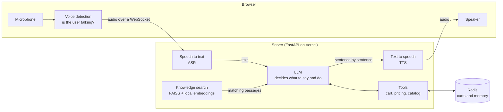

# Nimbus Voice Agent

**A voice assistant that talks to customers on a business-software website. It answers questions about products, plans and policies, and builds and checks out their cart, all by voice.**

Live site: **https://nimbus-shishir.vercel.app**. Bring your own API key; one OpenAI key is enough.

Nimbus is a made-up company that sells 24 cloud apps (CRM, accounting, HR, help desk and more) in Free, Starter, Professional and Enterprise plans. The website is the "store". The voice agent is the salesperson who never sleeps: you click the chat button, talk to it like a person, and it replies out loud.

> Nimbus is **not a real company**. Its products, prices and policies are invented for teaching. Checkout is a demo: no payment is ever taken.

---

## Contents

1. [Try it in one minute](#try-it-in-one-minute)
2. [What you can do on the site](#what-you-can-do-on-the-site)
3. [The Playground](#the-playground)
4. [How it works](#how-it-works)
5. [Why we built it this way](#why-we-built-it-this-way)
6. [How fast is it?](#how-fast-is-it)
7. [Your API keys and your privacy](#your-api-keys-and-your-privacy)
8. [Run it on your own computer](#run-it-on-your-own-computer)
9. [Deploy your own copy](#deploy-your-own-copy)
10. [Project layout](#project-layout)
11. [Tests](#tests)
12. [Limits and known gaps](#limits-and-known-gaps)

---

## Try it in one minute

1. Open **https://nimbus-shishir.vercel.app**.
2. Click **Talk to our voice agent** on the home page, or the round chat button in the corner.
3. Paste an API key and press **Save and start**. One [OpenAI key](https://platform.openai.com/api-keys) covers everything: listening, thinking and speaking. Gemini, Anthropic and ElevenLabs keys work too.
4. Press the microphone and say something like:
   - *"Which of your products have a free plan?"*
   - *"Add two CRM Professional seats to my cart."*
   - *"How much would I save paying yearly?"*
   - *"Okay, check out."*

You can interrupt it at any time: just start talking and it stops to listen.

The calls go to **your** AI account, so you pay your provider for them. A typical conversation costs a few cents.

---

## What you can do on the site

| Page | What it is for |
|---|---|
| **Home page chat** (any page, bottom-right button) | The finished agent in a small chat box. Type or talk. This is what a real customer would see. |
| **Agent** (`agent.html`) | The same agent, full screen: the conversation, the live cart next to it, and a short latency note on every reply. |
| **Playground** (`playground.html`) | The workshop. Every setting the agent uses can be changed here and tested straight away. See below. |
| **RAG Lab** (`rag.html`) | A look inside the agent's knowledge search: type a question, see which pieces of the knowledge base it finds, how they score, and where they sit on a 2D/3D map of all knowledge. |
| **Products, Pricing, Support, About** | The normal website the agent knows about. Its cart is the same cart the agent fills. |

The chat box, the Agent page and the cart share one conversation and one cart, so you can start talking on the home page and carry on in the full Agent page.

---

## The Playground

The Playground is where you take the agent apart and put it back together. Everything you change applies to your next message.

**API keys.** Paste one or more provider keys at the top. They stay in your browser.

**Agent brain.** This is the part that decides what to say.
- **LLM provider and model:** OpenAI, Google Gemini or Anthropic Claude, from fast and cheap to slow and clever.
- **System prompt:** the agent's personality and instructions. Edit it freely. The fixed rules that always follow your prompt (how to speak, when to use tools) are shown underneath, so nothing is hidden.
- **Reply length:** short, medium or long answers.
- **Knowledge, RAG or RAG-less:** *RAG* searches the knowledge base for the few passages that match each question. *RAG-less* hands the model the entire knowledge base (about 24,000 tokens) every time. Compare them and see the difference in speed and accuracy.
- **Top-k and reranking:** how many passages to fetch, and whether to re-sort them with a second, more careful model.
- **Memory:** how many recent turns are kept word for word. Older turns are folded into a short running summary, so long conversations stay cheap and fast. You can open "What the agent remembers" to see exactly what it knows.

**Voice.** This is the part that listens and speaks.
- **Speech recognition (ASR):** your browser's built-in recognizer, OpenAI, ElevenLabs or Gemini.
- **Speech synthesis (TTS):** OpenAI, ElevenLabs or Gemini, with a choice of voices.
- **Streaming or batch:** streaming starts speaking the first sentence while the rest is still being written; batch waits for the whole reply. Try both and hear the difference.
- **End-of-speech wait:** how long a pause has to last before the agent decides you have finished.
- **Playback buffer:** how much audio to collect before playing, to smooth over network hiccups.
- **⚡ Low-latency mode:** one switch that turns on every speed trick at once (see [How fast is it?](#how-fast-is-it)).

**Latency dashboard.** Every turn is timed stage by stage: end of speech, speech recognition, knowledge search, LLM, tools, speech synthesis, network and buffering. A bar shows where the time went. An **A/B runner** asks the same question twice, normal versus Low-latency, and puts the results side by side.

**Agent tools.** These are the 11 actions the agent can take: add to cart, remove from cart, clear the cart, cart total, check out (everything or a single item), yearly price, yearly savings, sort products by price, most expensive products, and knowledge search. Turn any of them off and see how the agent copes without it. **Try a tool** lets you run one by hand and watch the cart change.

---

## How it works

The agent is a **cascaded pipeline**: three specialist models in a row, with our own code in between.



What happens on every turn:

1. **The browser listens.** A small voice detector runs in your browser and works out when you start and stop talking, by comparing the loudness of your voice with the background noise. While you talk, audio streams to the server over a WebSocket.
2. **Speech becomes text.** The server forwards the audio to a speech-recognition service *while you are still speaking*. When you stop, only a short final step is left.
3. **The agent looks things up.** Your words are turned into a vector by a small embedding model that runs on the server itself, with no API call. That vector is matched against 282 passages of Nimbus knowledge (product features, plans, policies, FAQs). The best few are handed to the LLM.
4. **The LLM thinks and acts.** It reads the system prompt, recent conversation, memory summary, the passages and your question. If it needs to act, for example to add something to the cart, it calls a tool. Independent tools run in parallel.
5. **Text becomes speech, one sentence at a time.** As soon as the first sentence of the reply is complete, it goes to speech synthesis. You hear the beginning while the end is still being written.
6. **You can cut in.** If you talk while the agent speaks, it stops at once. It also remembers that it was cut off and only counts what you actually heard. Its memory marks the reply `[cancelled by the user]`, so it never assumes you heard the rest.

Text chat uses the same brain. It just skips steps 1, 2 and 5 and streams the reply as text.

---

## Why we built it this way

**A cascaded pipeline, not one "speech-to-speech" model.** Using separate speech-to-text, LLM and text-to-speech models lets us pick the best (or cheapest, or fastest) model for each job, swap providers freely, see the exact text at every step, and use reliable tool calling and knowledge search. The price is some extra latency between stages, which is what most of the speed work below attacks.

**Several providers for every stage.** OpenAI, Google, Anthropic and ElevenLabs each win on something: price, voice quality, speed or accuracy. Being able to switch in the Playground turns "which is better?" into something you can measure.

**Bring your own key.** The site is public, so the server never pays for anyone's calls. Each visitor's key stays in their own browser and travels only with their own requests. In production the server refuses to fall back to any key of its own.

**RAG with FAISS and a small local embedding model.** The knowledge base is small (282 passages), so a plain exact-search FAISS index is instant: a search takes about 15 milliseconds. The embedding model (`bge-small-en-v1.5`) runs on the server with no network call and no API key. On our test questions the right passage is ranked first 97% of the time and is in the top five 100% of the time.

**Reranking off by default.** A second "reranker" model can re-sort the results more carefully. On our test set it found nothing that plain search missed, and it added 140 to 400 ms per question, so it is a switch in the Playground rather than the default.

**RAG-less mode as a comparison.** Sending the whole 24,000-token knowledge base every time is simpler and never misses a passage, but it is slower and costs more per message. Having both lets you see the trade-off for yourself.

**Tools for anything that must be exact.** LLMs are bad at arithmetic and should not be trusted to remember a cart. Prices, savings, sorting and every cart change go through small, tested functions; the model only decides *which* tool to call.

**Memory: recent turns word for word, older turns summarized.** This keeps the prompt short (fast and cheap) without forgetting what you said ten minutes ago. Summaries are written in the background after a reply is sent, so they never slow a turn down.

**Voice detection in the browser.** Deciding "has the user stopped talking?" right next to the microphone saves a network round trip on every turn. The detector keeps learning the room's background noise, so a fan or a noisy café doesn't keep the turn open forever.

**Audio worklets for playback.** Audio is played by a tiny jitter buffer running on the browser's audio thread, which smooths over network gaps and can be flushed instantly when you interrupt.

**FastAPI and one WebSocket per voice session.** Python is where the speech, embedding and LLM libraries are. One long-lived WebSocket carries audio both ways with no per-message connection cost.

**Vercel plus Upstash Redis.** The whole app, pages, API and WebSocket included, runs as one Vercel function. Vercel may run several copies at once and may close a voice connection after a few minutes, so carts and conversation memory are kept in Redis. Any copy can then pick up any conversation, and the browser quietly reconnects without losing your place.

---

## How fast is it?

"Latency" here means the time from the moment you stop talking to the moment you hear the first word of the reply.

With **⚡ Low-latency mode** on (the default on the home page and Agent page), turns in our tests took **about 4 seconds** from end of speech to first audio. The fastest was **2.9 seconds**; cart actions, which need two LLM calls, took longer. A typical turn breaks down as:

| Stage | Typical time |
|---|---|
| Waiting to be sure you've finished | ~0.7 s |
| Final speech recognition | ~0.7 s |
| LLM until the first sentence is ready | 1–2 s |
| Speech synthesis until the first audio | ~0.8 s |

What Low-latency mode does:
- Uses each provider's fastest model, with minimal "thinking".
- Fetches knowledge before the LLM call, instead of letting the LLM ask for it (which costs a whole extra round trip).
- Sends the LLM only the tools a question plausibly needs, and asks for short, answer-first replies.
- Starts speaking at the first complete clause and synthesizes two sentences at once.
- Waits less after you stop talking when your sentence clearly sounds finished, and longer when it trails off with "and…" or "um…".
- Keeps a warm speech-recognition connection ready for your next turn and reuses connections to every provider.
- Says a short "Okay." the moment a cart change is done, while the LLM writes the confirmation.
- Plays a short buffer that grows only if the network stutters.

The full plan, including the ideas we tried and dropped, is in [`docs/latency-reduction-plan.md`](docs/latency-reduction-plan.md). The original build plan is in [`docs/plan.md`](docs/plan.md).

---

## Your API keys and your privacy

- Keys are saved in **your browser's localStorage** and sent to the Nimbus server only with your own requests, in request headers.
- The server uses a key only for the request it came with. It **never writes keys to disk, a database or logs**.
- In production the server **never** uses a key of its own, so nobody can run up someone else's bill.
- Anyone with access to your browser profile can read keys in localStorage. Use your own computer, and remove a key with the **Keys** button (chat box) or **Clear** (Playground) when you're done.
- Conversations and carts are stored in Redis under random ids, and expire after 7 days (conversations) and 30 days (carts).

---

## Run it on your own computer

You need **Python 3.12** and a terminal.

```bash
git clone https://github.com/shishirshetty111/nimbus-voice-agent.git
cd nimbus-voice-agent
python -m venv .venv
# Windows: .venv\Scripts\activate     macOS/Linux: source .venv/bin/activate
pip install -r requirements-dev.txt
uvicorn backend.app:app --port 8093
```

Open **http://localhost:8093** and paste your key in the chat box or the Playground.

The first start downloads the small embedding model (about 150 MB); after that it starts in seconds.

**Optional:** to skip pasting keys while developing, put them in a `.env` file next to the project folder (`OPENAI_API_KEY=...`, `GEMINI_API_KEY=...`, `ANTHROPIC_API_KEY=...`, `ELEVENLABS_API_KEY=...`). The local server uses those when the browser sends none. The production site never does.

**Rebuilding the knowledge base:** the knowledge comes from `data/catalog.json`. After changing it, run `python -m scraper.scrape` and then `python -m backend.rag.build_index` to regenerate `knowledge/` and the search index in `rag_store/`.

---

## Deploy your own copy

The app deploys to [Vercel](https://vercel.com) as one Python function.

1. Import this repository into Vercel (or run `vercel deploy` from the folder).
2. Add a Redis database: in your Vercel project, open **Storage → Marketplace → Upstash for Redis** and connect it. This sets `KV_REST_API_URL` and `KV_REST_API_TOKEN` automatically.
3. Add the environment variable `VERCEL_SUPPORT_LARGE_FUNCTIONS=1`. The Python libraries plus the embedding model come to about 750 MB, over the standard 500 MB limit.
4. Deploy. Visitors bring their own keys, so there are no AI keys to configure.

Without Redis it still works on a single server; carts and memory are then kept on that server's disk and in its memory.

---

## Project layout

```
.
├── index.html, products.html, product.html, pricing.html, support.html, about.html
│                         the Nimbus website
├── agent.html            the finished voice agent, full screen
├── playground.html       every setting, live
├── rag.html              RAG Lab: look inside the knowledge search
├── main.py               Vercel entrypoint (imports backend/app.py)
├── vercel.json           function settings for Vercel
├── data/catalog.json     the single source of truth: products, plans, policies
├── knowledge/            knowledge passages generated from the catalog
├── rag_store/            the prebuilt search index and 2D/3D maps
├── scraper/              turns catalog.json into knowledge/
├── backend/
│   ├── app.py            the web server: pages, API, voice WebSocket
│   ├── chat.py           one conversation turn: knowledge, prompt, LLM, tools, memory
│   ├── prompts.py        the system prompt and its fixed rules
│   ├── latency_profile.py  what Low-latency mode changes
│   ├── memory.py         recent turns + running summary
│   ├── kv.py             Redis for shared state in production
│   ├── llm/              OpenAI, Gemini and Anthropic adapters (streaming + tool calls)
│   ├── rag/              embeddings, FAISS index, reranker, evaluation
│   ├── tools/            cart, pricing and catalog tools
│   └── voice/            speech recognition, speech synthesis, the voice session
├── assets/               site styles and scripts
│   └── voice/            chat box, Agent page, Playground, voice client, audio worklets
└── tests/                automated tests
```

---

## Tests

```bash
pip install -r requirements-dev.txt
pytest -q
```

The 80 tests cover the knowledge scraper, search quality, every tool, the chat loop, memory and barge-in, the voice session, Low-latency mode, parallel tool calls and production behaviour (shared Redis state, no server keys). They use fake providers, so they need no API keys and cost nothing.

---

## Limits and known gaps

- **English only.** Speech recognition and replies are fixed to English.
- **Latency is about 4 seconds on a typical turn, not 2.** The remaining time is mostly the LLM and speech services themselves. Ideas still to try are listed in the latency plan.
- **Demo checkout.** Orders are recorded, but no payment is taken and nothing is delivered.
- **Voice connections reconnect every few minutes** on Vercel's free plan. It's automatic and keeps your conversation, but a reply in progress at that moment can be lost.
- **No phone line yet.** Calling the agent by phone is planned but not built.

---

Built on the Nimbus starter website from the Voice Agents bootcamp by VizuaraAI.
